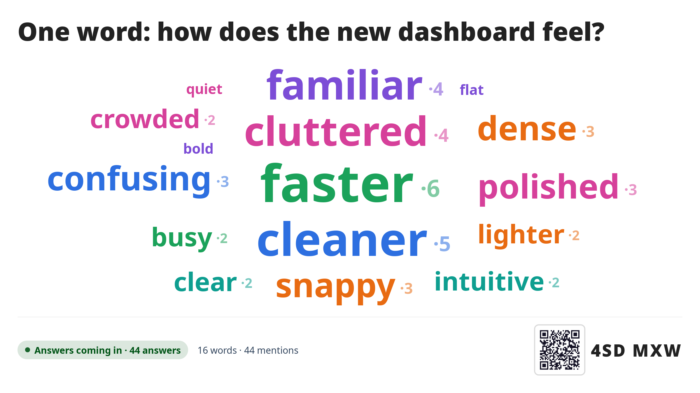

<!--
  - SPDX-FileCopyrightText: 2026 hotochan123
  - SPDX-License-Identifier: AGPL-3.0-or-later
-->
# Pulse – live polls and quizzes for Nextcloud
<!-- factory:ai-banner -->
> **Vibe-coded:** Pulse is written by AI coding agents (Anthropic's Claude Code),
> not by hand. The maintainer sets the goals, makes the product decisions and tries
> the app out in the browser; there has been no independent human code review and
> no security audit. Details: [How this app is built](#how-this-app-is-built-ai-disclosure).
<!-- /factory:ai-banner -->

Pulse brings live polls, word clouds and quizzes for presentations into your
own Nextcloud, as a self-hosted alternative to services such as Kahoot!,
Mentimeter or Slido. The presenter opens a room and projects a six-character
code; the audience joins through a public link, without a Nextcloud account,
and votes from their phones. Results appear live on the projector.



**Status:** version 0.20.2 is in the
[Nextcloud App Store](https://apps.nextcloud.com/apps/pulse). What changed in
each version is in the [changelog](CHANGELOG.md).

- [Features](#features)
- [Requirements](#requirements)
- [Installation](#installation)
- [Known limits](#known-limits)
- [Development](#development)
- [How this app is built (AI disclosure)](#how-this-app-is-built-ai-disclosure)
- [Licence](#licence)

Every feature in detail, including the self-paced quiz step by step:
[`docs/FEATURES.md`](docs/FEATURES.md). Installation from the repository,
limits and their settings, embedding in PowerPoint, security notes and all
known limits for administrators: [`docs/ADMIN.md`](docs/ADMIN.md).
Architecture, data model, tests and releases:
[`docs/DEVELOPMENT.md`](docs/DEVELOPMENT.md).

## Features

- **Two roles:** the moderator signs in to Nextcloud; participants join with
  the room code or a QR code, without an account.
- **Polls** (anonymous): multiple choice, word cloud, scale (single slider,
  spectrum or compass), ranking and matching.
- **Quizzes** with nicknames, points and a leaderboard: multiple choice,
  true/false, multiple answers, number guess, free text (graded afterwards),
  ranking and matching, each with an optional explanation shown with the
  answer.
- **Moderated or self-paced:** everybody answers the same question with a
  countdown, or everybody works through the quiz alone on their phone – as a
  race in the room or as homework with a deadline.
- **Presenting:** decks of several questions, an image per question, a
  projector view, practice runs, and a PowerPoint add-in that puts the
  projector view on a slide.
- **Filter before the projector:** hide any free-text or word-cloud answer
  with one tap; optionally the AI set up in your Nextcloud checks new answers
  first.
- **AI quiz draft:** 5–10 questions with answers from a topic or a file in
  your Nextcloud, when an administrator has set up an AI provider.
- **Group with AI:** sort the free-text or word-cloud answers into a few
  themes, check them on the desk and show them on the projector.
- **Summary with AI:** key points of the free-text answers and every result
  in numbers as a Markdown file in your Nextcloud.
- **AI quality:** AI results depend on your model. Pulse only sends prompts
  to the AI provider set up in your Nextcloud; how good drafts, filters,
  themes and summaries are depends strongly on that model. Pulse is tested
  with Mistral Small 4 (via Infomaniak); smaller or local models may give
  weaker results. The prompts keep being improved.
- **Results:** a summary with CSV export, downloaded or saved into your
  Nextcloud files.
- **Tidy by itself:** rooms nobody has used for 30 days are deleted
  automatically.
- **Languages:** English and German.

## Requirements

Nextcloud 34 or 35 and the PHP version it needs (the tests run on PHP 8.2 and
newer), with SQLite, MySQL/MariaDB or PostgreSQL. A memory cache (Redis or
APCu) is recommended: without one, Pulse reads more from the database while
phones wait for changes. No High Performance Back-end is needed. The AI
features appear only when an administrator has set up a text-generation
provider in Nextcloud's AI settings.

## Installation

An administrator installs Pulse from the Nextcloud App Store: on the Apps page
of Nextcloud, search for "Pulse", or run `occ app:install pulse`. A new
release can take some hours to show up there.

For the PowerPoint add-in the web server must allow the projector view to be
framed; the setup check "Pulse: embedding in PowerPoint" under Administration
→ Overview says whether that works. Installing from the repository (never
straight into the web root), embedding, and the limits you can change with
`occ` are described in [`docs/ADMIN.md`](docs/ADMIN.md).

## Known limits

The most important ones; the full list is in
[`docs/ADMIN.md`](docs/ADMIN.md#known-limits-and-possible-extensions).

- **One vote per person is not guaranteed.** Without an account, a cookie
  only discourages voting twice; another browser or a script can vote again
  and again. Treat the result of an anonymous poll as an impression, not a
  head count.
- **Self-paced quizzes can be scouted** with a second identity. For anything
  graded, give feedback "At the end", lock joining once the class is in and
  check the names.
- **Many people behind one network address** (a lecture hall on one NAT)
  share the limits on new names; raise them with `occ` when needed.
- **Polling, not push:** phones ask the server for changes every second or
  two.
- **Not yet:** an image hotspot question type, a rejoin code for switching
  devices in a self-paced quiz, and languages other than English and German.

## Development

```
npm ci && npm run build     # the bundles in js/ (Node.js 22.18)
npm run l10n:check          # translations complete
tests/run.sh                # PHPUnit inside a Nextcloud container
for f in dev/unit/*.test.mjs; do TZ=Europe/Berlin node "$f"; done   # JavaScript unit tests
```

The HTTP simulation, the integration and load runs, the browser tests, the
screenshot harness, the architecture, the data model and the release steps
are described in [`docs/DEVELOPMENT.md`](docs/DEVELOPMENT.md).

## How this app is built (AI disclosure)
<!-- factory:ai-about -->
Pulse is vibe-coded. The maintainer ([hotochan123](https://github.com/hotochan123))
does not write the code by hand. They set the goals, make the product decisions
and try the app out in the browser. Everything else is written by AI coding
agents:

- all code – PHP, JavaScript/Vue, CSS and the database migrations;
- the tests and the development tools;
- the documentation, including this README, and the translations.

**Tool and models.** The agents run in Anthropic's Claude Code. The private
development history up to this release has 152 commits (merges not
counted), from 29 September 2026 to 8 November 2026. Each commit written by an agent carries a
`Co-Authored-By` trailer naming the model: Claude Opus 5.5 (150 commits). 2 commits without such a trailer came from people by hand (contributions through the public repository). Before this repository, Pulse was developed in an earlier private repository: 87 commits from 16 July to 29 September 2026, with Claude Opus 4.8 (37), Claude Opus 5 (44) and Claude Opus 5.5 (6).

**How a change is made.** The maintainer decides what goes in, in question
rounds with an agent. Each change then runs as one job of an automated
pipeline: an agent writes a short specification with acceptance criteria,
builds the change with tests, runs the checks and reviews its own change; a
second agent that has not seen the work reviews it again for correctness,
security and usability, and only then is it merged. The maintainer tries the
result in the browser before a release.
<!-- /factory:ai-about -->

**Verification.** Pulse is checked by a database-free PHPUnit suite, JavaScript
unit tests for the browser-free rules (self-paced timing, question types,
routes, word-cloud layout and more), an HTTP simulation of complete poll and
quiz runs, a load run with 60 phones in a self-paced race and browser tests
with Playwright (Chromium) that drive the moderator desk, the phone page and
the projector. Every change has to pass these checks before it is merged; they
run in the private development repository, not on GitHub. They build the
bundle, check the translations and `info.xml` against the App Store schema,
pack a test release archive, run the JavaScript unit tests, check the syntax
of every PHP file and development script, run PHPUnit four times (on the PHP
of the Nextcloud 34 and 35 images and on PHP 8.2 and 8.3), play the simulation
through on throwaway Nextcloud instances with SQLite, PostgreSQL, MariaDB and
MySQL, and run the load and browser tests on throwaway instances. The
screenshot harness (`dev/design-shots`) needs a running Nextcloud and is run
by hand; during development the app was also fuzzed with one-off scripts that
are not in this repository. In September 2026 AI agents of the same kind
reviewed the code for security problems; the fixes are listed under
"Security" in the [changelog](CHANGELOG.md), and what remains is described in
the [security notes](docs/ADMIN.md#security-notes).

<!-- factory:ai-outro -->
**History.** This public repository gets one commit per release, exported from
the private development repository; the development history, with the job
files of the pipeline, stays private. The code is the same.

**What this means for you.** All tests and reviews above were written or done
by AI agents of the same kind, so they check the code against the agents' own
reading of the requirements. There has been **no independent human code review
and no security audit.** Evaluate Pulse yourself before you rely on it,
especially for anything sensitive or open to the internet. Issues and reviews
are welcome ([issue tracker](https://github.com/hotochan123/nextcloud-pulse/issues)); how to report a
security problem: [`SECURITY.md`](SECURITY.md).
<!-- /factory:ai-outro -->

## Licence

AGPL-3.0-or-later, see [`LICENSE`](LICENSE). Pulse comes without any warranty.
Every source file carries the matching SPDX header. The one exception inside a
file: the `copy`, `more`, `plus` and `close` icons in
`src/components/ui/PulseIcon.vue` are taken from or adapted from
[Feather Icons](https://github.com/feathericons/feather) (`copy` with a
slightly smaller front square), under the MIT License:

<details>
<summary>Feather Icons licence text</summary>

```text
The MIT License (MIT)

Copyright (c) 2013-2023 Cole Bemis

Permission is hereby granted, free of charge, to any person obtaining a copy
of this software and associated documentation files (the "Software"), to deal
in the Software without restriction, including without limitation the rights
to use, copy, modify, merge, publish, distribute, sublicense, and/or sell
copies of the Software, and to permit persons to whom the Software is
furnished to do so, subject to the following conditions:

The above copyright notice and this permission notice shall be included in all
copies or substantial portions of the Software.

THE SOFTWARE IS PROVIDED "AS IS", WITHOUT WARRANTY OF ANY KIND, EXPRESS OR
IMPLIED, INCLUDING BUT NOT LIMITED TO THE WARRANTIES OF MERCHANTABILITY,
FITNESS FOR A PARTICULAR PURPOSE AND NONINFRINGEMENT. IN NO EVENT SHALL THE
AUTHORS OR COPYRIGHT HOLDERS BE LIABLE FOR ANY CLAIM, DAMAGES OR OTHER
LIABILITY, WHETHER IN AN ACTION OF CONTRACT, TORT OR OTHERWISE, ARISING FROM,
OUT OF OR IN CONNECTION WITH THE SOFTWARE OR THE USE OR OTHER DEALINGS IN THE
SOFTWARE.
```

</details>

Pulse is an independent project and is not affiliated with or endorsed by the
providers of Kahoot!, Mentimeter or Slido; these names are trademarks of their
respective owners.
